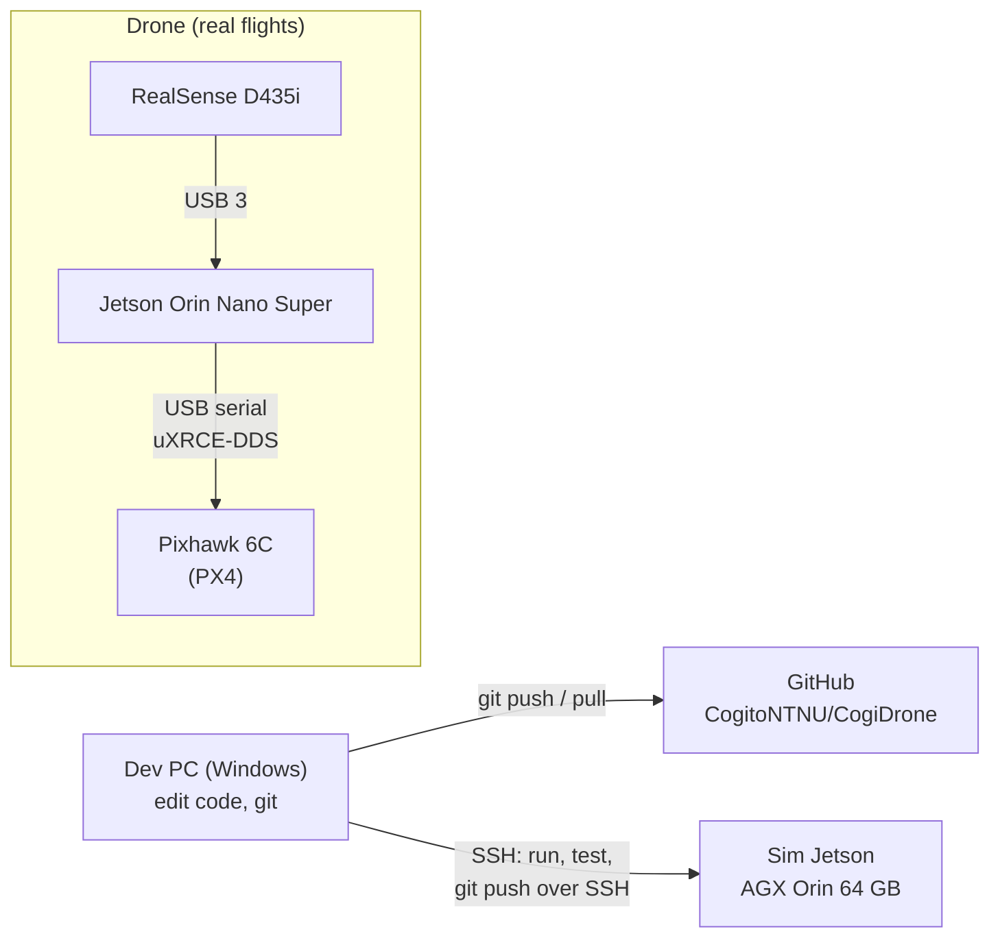
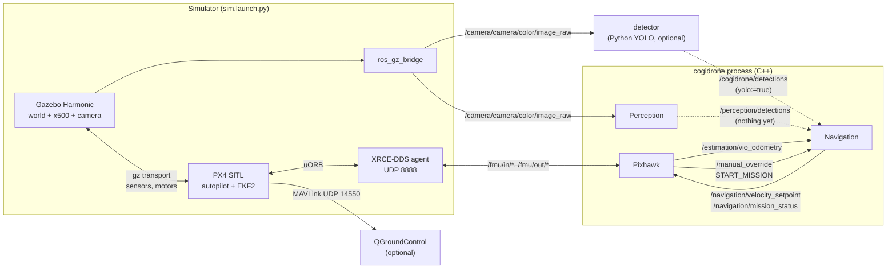
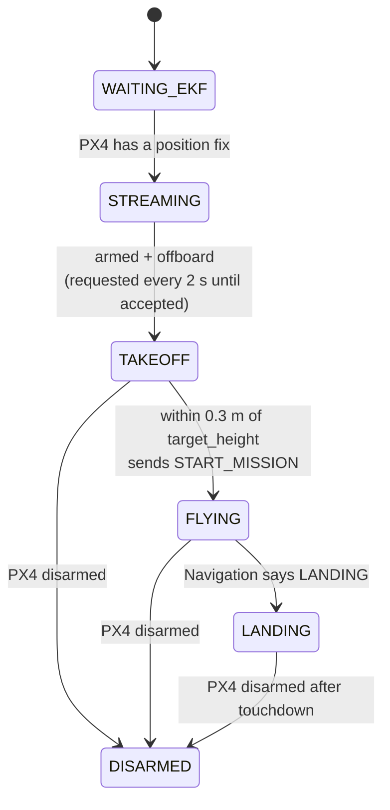

# How everything is connected

One page that shows which machine runs what, which program talks to which, and over which
topic. Details live in the linked pages:

| Page | What it covers |
|---|---|
| [hardware.md](hardware.md) | Parts on the drone, wiring, power, PX4 parameters |
| [jetson.md](jetson.md) | Installing and running everything natively on the Jetsons |
| [sim.md](sim.md) | The Docker sim for laptops (Windows / Linux / macOS) |

## 1. Machines



- **The dev PC** is where code is written and the only machine that pushes to GitHub.
- **The sim Jetson** has no GitHub login. Code reaches it over SSH from the PC
  (`git push ssh://<user>@<sim-jetson>/~/Cogito/CogiDrone <branch>`), and you run the sim there.
- **The drone** runs the same code. The only difference is that PX4 runs on the Pixhawk and the
  images come from the real camera instead of Gazebo (see [section 5](#5-sim-vs-real-drone)).

## 2. The two ways to fly the sim

Both start the same simulator. They differ in **who flies the drone**. Never run both at once:
two programs sending setpoints to PX4 fight each other.

| | C++ core (main path) | Python reference |
|---|---|---|
| Launch | `ros2 launch cogidrone_bringup sim_cpp.launch.py` | `ros2 launch cogidrone_bringup sim.launch.py` |
| Who flies | `cogidrone` (C++, `src/`) | `offboard` (Python, `ros2_ws/src/cogidrone_control`) |
| Behaviour | Take off to 2.5 m, Navigation state machine (search / follow), land on request | Take off to 3 m, yaw toward the person YOLO sees |
| YOLO boxes | Only with `yolo:=true` | Always |
| Fly by keyboard | No | Add `autonomy:=false`, then `ros2 run cogidrone_control teleop` |

## 3. What runs in the sim



Dashed arrows are planned or optional. Today the C++ Perception loads stub models and publishes
nothing, so without `yolo:=true` Navigation stays in `SEARCHING` (hover and spin slowly).

### Inside the `cogidrone` process

`main.cpp` creates one `Drone`, which owns three subsystems. Each one is a ROS 2 node, and all
three spin in one `MultiThreadedExecutor` (intra-process, so messages between them are not copied).

| Subsystem | File | Job |
|---|---|---|
| `Perception` | `src/perception/` | Camera image → detections. **Models are stubs for now** |
| `Navigation` | `src/navigation/` | Mission state machine: `IDLE → SEARCHING → PERSON_DETECTED → FOLLOWING`, plus `LANDING` / `EMERGENCY`. Outputs a velocity |
| `Pixhawk` | `src/controller/` | The only link to PX4. Converts frames, arms, takes off, follows Navigation's velocity, lands |
| Estimation | `src/estimation/` | Not written yet. Until then `Pixhawk` publishes PX4's EKF2 estimate as the odometry |
| Representation | `src/representation/` | Not written yet (map / obstacles) |

### Pixhawk state machine



In `FLYING` it follows Navigation's velocity while Navigation keeps sending one (at least every
0.5 s). If Navigation goes quiet it holds the current position instead of drifting.

## 4. Topics

| Topic | Type | From | To | Frame |
|---|---|---|---|---|
| `/fmu/out/vehicle_local_position_v1` | `px4_msgs/VehicleLocalPosition` | PX4 | Pixhawk, Python nodes | NED |
| `/fmu/out/vehicle_status_v1` | `px4_msgs/VehicleStatus` | PX4 | Pixhawk, Python nodes | — |
| `/fmu/in/offboard_control_mode` | `px4_msgs/OffboardControlMode` | Pixhawk | PX4 | — |
| `/fmu/in/trajectory_setpoint` | `px4_msgs/TrajectorySetpoint` | Pixhawk | PX4 | NED |
| `/fmu/in/vehicle_command` | `px4_msgs/VehicleCommand` | Pixhawk | PX4 | — |
| `/estimation/vio_odometry` | `nav_msgs/Odometry` | Pixhawk (stand-in for Estimation) | Navigation | ENU |
| `/navigation/velocity_setpoint` | `geometry_msgs/TwistStamped` | Navigation | Pixhawk | ENU, world frame |
| `/navigation/mission_status` | `std_msgs/String` | Navigation | Pixhawk | — |
| `/manual_override` | `std_msgs/String` | Pixhawk, or you | Navigation | — |
| `/camera/camera/color/image_raw` | `sensor_msgs/Image` | ros_gz_bridge (sim) / realsense-ros (drone) | Perception, detector | camera |
| `/perception/detections` | `vision_msgs/Detection2DArray` | Perception (nothing yet) | Navigation | image |
| `/cogidrone/detections` | `vision_msgs/Detection2DArray` | detector (YOLO) | Navigation (with `yolo:=true`), `offboard` | image |
| `/cogidrone/detections/image` | `sensor_msgs/Image` | detector | `rqt_image_view` (camera with boxes) | image |

PX4 topics with versioned messages end in `_v1`. A wrong name receives nothing and gives no error.

`/manual_override` takes plain words, so you can steer the mission from a terminal:

```bash
ros2 topic pub --once /manual_override std_msgs/msg/String "{data: LAND}"
# also: START_MISSION, RETURN_HOME, EMERGENCY_STOP
```

### Frames: ENU vs NED

PX4 uses **NED** (x north, y east, z down, so up is negative). ROS uses **ENU** (x east,
y north, z up). The `Pixhawk` class is the only code that converts between them. Everything
else in `src/` is ENU:

| | ENU (ROS, our code) | NED (PX4) |
|---|---|---|
| x | east | north |
| y | north | east |
| z | up | down |
| yaw | from east, counter-clockwise | heading from north, clockwise |

## 5. Sim vs real drone

Only the bottom layer changes. The topic names are the same, so the code above it does not change.

| | Sim | Real drone |
|---|---|---|
| Autopilot | PX4 SITL on the sim Jetson | PX4 on the Pixhawk 6C |
| PX4 ↔ ROS | `xrce-agent udp4 -p 8888` | `xrce-agent serial --dev /dev/ttyUSB0 -b 921600` (TELEM2, see [hardware.md](hardware.md#pixhawk--jetson-link)) |
| Camera | Gazebo camera → `ros_gz_bridge` | RealSense D435i → `realsense2_camera` |
| Depth image | `32FC1`, metres | `16UC1`, millimetres |
| Position | Gazebo GPS → PX4 EKF2 | GPS outdoors, cuVSLAM later (see [jetson.md](jetson.md#localization-and-mapping-plan)) |
| Started by | `sim_cpp.launch.py` | Not written yet |

## 6. Where things live in the repo

| Path | What |
|---|---|
| `src/` | The C++ drone core (`cogidrone`). Built by CMake on its own, or by colcon through `ros2_ws/src/cogidrone_core` |
| `ros2_ws/src/cogidrone_core/` | A thin ROS package that builds `src/` so `ros2 launch` can start it |
| `ros2_ws/src/cogidrone_bringup/` | Launch files (`sim.launch.py`, `sim_cpp.launch.py`) and the Gazebo → ROS bridge config |
| `ros2_ws/src/cogidrone_perception/` | Python YOLO `detector` |
| `ros2_ws/src/cogidrone_control/` | Python `offboard` controller and keyboard `teleop` (reference / manual flying) |
| `sim/` | Gazebo world (`worlds/cogidrone.sdf`, two people) and drone model (`models/cogidrone_x500`) |
| `scripts/jetson/` | Native install scripts, `env.sh` (sourced by `~/.bashrc`), smoke test, `qgc` launcher |
| `docker/sim/`, `compose.yaml`, `scripts/sim.sh` | The Docker sim for laptops (see [sim.md](sim.md)) |
| `docker/Dockerfile`, `build.sh`, `build.bat` | Cross-compiling `src/` for the Jetson from another machine |
| `vendored/` | Pre-built aarch64 ROS 2 + `px4_msgs` for cross-compiling `src/` from Windows |
