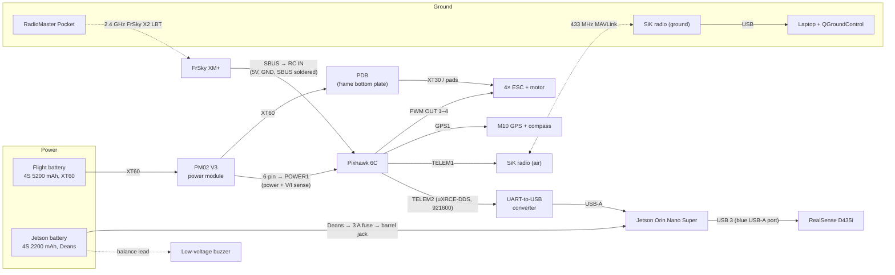

# Hardware

There are two machines: the **sim box** for development and the **drone** that flies. The same code
runs on both (see [jetson.md](jetson.md)). How the software connects is in
[architecture.md](architecture.md).

| Machine | Board | Where | Used for |
|---|---|---|---|
| Sim / dev box | Jetson AGX Orin 64 GB | Desk, reached over SSH | Gazebo + PX4 SITL + the full software stack |
| Drone | Holybro X500 V2 + Pixhawk 6C + Jetson Orin Nano Super 8 GB + RealSense D435i | The airframe | Real flights |

Prices, vendors and the purchase reasoning are in the
[build sheet](https://claude.ai/code/artifact/2a45d089-8410-4873-ada0-f07cd1a426c0). This page
covers what is connected to what.

## Sim box (AGX Orin)

```bash
ssh <user>@<sim-jetson-host>
```

<!-- TODO: put the hostname here (not passwords). -->

- Over SSH there is no screen, so start the sim with `headless:=true`. To see the camera and
  topics from a laptop, use Foxglove (`foxglove_bridge` is installed) or `ros2` on the same
  `ROS_DOMAIN_ID` on the same network.
- No hardware is plugged into it for the sim. PX4 runs as SITL on the Jetson itself, and the
  agent uses UDP.
- To use the RadioMaster Pocket as a joystick in the sim, plug it into the sim box over USB (see
  [jetson.md](jetson.md#fly-with-the-radiomaster-pocket-usb-joystick)).

## Drone: parts

| Part | Model | Role |
|---|---|---|
| Frame kit | Holybro X500 V2 dev kit | Frame, power distribution board (PDB), 4× BLHeli_S 20 A ESC, 4× 2216 KV920 motors, props |
| Flight controller | Pixhawk 6C (in kit) | Runs PX4: stabilisation, failsafes, motor output |
| Power module | Holybro PM02 V3 (in kit) | Measures the flight battery's voltage and current for PX4, and powers the Pixhawk |
| GPS | Holybro M10 GPS + compass (in kit) | Position and heading |
| Telemetry radio | Holybro SiK, **433 MHz** pair (in kit) | Pixhawk ↔ QGroundControl on the ground laptop. 915 MHz is not legal in Norway |
| RC transmitter | RadioMaster Pocket, CC2500 LBT (2× 18650 cells) | Manual control and safety override |
| RC receiver | FrSky XM+ (ACCST V2) | Sends SBUS to the Pixhawk |
| Companion computer | Jetson Orin Nano Super 8 GB dev kit | ROS 2, YOLO, cuVSLAM, offboard control |
| Camera | Intel RealSense D435i | RGB, depth, stereo IR and IMU |
| Pixhawk ↔ Jetson link | Holybro UART-to-USB converter | TELEM2 → Jetson USB-A |
| Flight battery | Sunpadow 4S 5200 mAh 110C, XT60 | Powers motors and Pixhawk |
| Jetson battery | 4S 2200 mAh 35C, Deans | Powers **only** the Jetson (and the camera through its USB port) |
| Jetson power lead | Deans pigtail → 3 A inline fuse → 5.5×2.5 mm barrel plug | Battery to Jetson barrel jack, no converter |
| Low-voltage buzzer | Generic, on the Jetson battery's balance lead | The only low-battery warning for the Jetson pack |
| Charger | SkyRC e450 | Charges both 4S packs, one at a time |

## Drone: how it is connected



### Power

There are **two separate power systems**. They share nothing.

1. **Flight battery → PM02 → PDB → ESCs.** The PM02 also powers the Pixhawk through POWER1 and
   reports battery voltage and current to PX4. That is what the battery failsafe uses. The
   Pixhawk powers the GPS, SiK radio and receiver through their ports.
2. **Jetson battery → fuse → Jetson barrel jack.** The Jetson accepts 9–20 V on the jack, and a 4S
   pack is 12.0–16.8 V, so it connects directly with no converter. The Jetson powers the D435i over
   USB. Keeping it separate keeps motor noise and voltage sag away from the Jetson.

Rules for the Jetson lead:

- **The centre pin is positive.** Check polarity with a multimeter before the first connection.
  Nothing between the battery and the Jetson protects against reversed polarity.
- The plug must be **5.5 × 2.5 mm**, not the similar 5.5 × 2.1 mm. A loose plug reboots the Jetson
  in flight.
- The fuse protects the jack, which is rated for 3.5 A. A nearly empty pack under full load (25 W
  mode plus the camera) draws about 2.5 A, so use a slow-blow fuse.
- **PX4 cannot see the Jetson battery.** The buzzer is its only low-voltage warning. Charge both
  packs before every session.

### Data links

| From | Port | To | Protocol | Notes |
|---|---|---|---|---|
| Pixhawk | TELEM1 | SiK air radio | MAVLink, 57600 | Kit cable. Ground radio plugs into the laptop over USB |
| Pixhawk | TELEM2 | UART-to-USB → Jetson USB-A | **uXRCE-DDS**, 921600 | This is how ROS 2 talks to PX4 (`/fmu/in/*`, `/fmu/out/*`) |
| Pixhawk | GPS1 | M10 GPS | — | Kit cable, includes the compass |
| Pixhawk | RC IN | XM+ SBUS pad | SBUS | Solder +5V, GND and SBUS on the XM+ to the Pixhawk's RC cable |
| Pixhawk | PWM OUT 1–4 | ESC signal wires | PWM / DShot | Assign in QGC → *Vehicle Setup → Actuators* |
| Pixhawk | POWER1 | PM02 V3 | analog V/I | PM02 V3 is the analog module the 6C needs (not PM02D) |
| Jetson | USB 3 (blue USB-A) | D435i | USB 3 | Must be USB 3. On USB 2 the camera falls back to low resolution and frame rates |
| Jetson | USB-C | — | — | Keep free for flashing and recovery |

**Motor order** (PX4 Quadrotor X, viewed from above, nose up):

```
   3 (CW)     1 (CCW)
        \  ^  /
         \ | /
          [ ]
         /   \
        /     \
   2 (CCW)    4 (CW)
```

Check every motor's position and spin direction in QGC's Actuators tab **with the props off**.

### Pixhawk ↔ Jetson link

The real drone connects the Pixhawk's TELEM2 to a Jetson USB-A port through the UART-to-USB
converter. On the Jetson it shows up as a USB serial device, normally `/dev/ttyUSB0`
(`ls /dev/serial/by-id/` lists it). Start the agent on that device:

```bash
xrce-agent serial --dev /dev/ttyUSB0 -b 921600
```

> [jetson.md](jetson.md#4-real-drone-orin-nano-super) and the install scripts still use
> `/dev/ttyTHS1`. That is the Jetson's 40-pin header UART, which only applies if TELEM2 is wired
> straight to the header (3.3 V TX/RX/GND, crossed) instead of through the converter. Pick one.

TELEM2 runs **uXRCE-DDS, not MAVLink**. The build sheet says to set up a MAVLink "Onboard"
instance on TELEM2, but our code uses `px4_msgs` over XRCE-DDS, so don't. PX4 parameters (QGC →
Parameters, then reboot):

| Parameter | Value |
|---|---|
| `UXRCE_DDS_CFG` | `TELEM2` |
| `SER_TEL2_BAUD` | `921600` |
| `UXRCE_DDS_DOM_ID` | same as `ROS_DOMAIN_ID` (0) |
| `MAV_1_CONFIG` | must **not** be TELEM2 |

A wrong port, baud rate or domain ID all fail silently: no `/fmu/...` topics and no error.

### RC link

- Set the Pocket's internal module to **FrSky X2 (LBT)**, not D16/X. The XM+ ships with ACCST V2.
  A V1/V2 mismatch still binds with a solid LED but sends no SBUS.
- Set the XM+ to SBUS output.
- Confirm the sticks move in QGC → *Radio*. The LED alone doesn't prove the link works.

### Camera mounting

The D435i faces forward. The sim model puts `camera_link` **0.12 m forward and 0.242 m up**
from `base_link` (`sim/models/cogidrone_x500/model.sdf`). If the real mount is in a different
place, measure it and update the TF and the sim model so they match.

<!-- TODO: measured camera position on the real drone. -->

## Firmware versions

| Item | Version | Why it matters |
|---|---|---|
| PX4 on the Pixhawk | v1.17 | Must match `px4_msgs` (`release/1.17`) and SITL |
| JetPack (Orin Nano) | 7.2.1 | Same as the sim box |
| XM+ firmware | ACCST V2 | Must match the Pocket's FrSky X2 setting |

## Bench checklist before the first flight

- [ ] Jetson lead polarity checked with a multimeter, 5.5 × 2.5 mm plug fits tightly
- [ ] Flashing jumper removed (J14 pins 9–10 are only for recovery mode)
- [ ] Low-voltage buzzer goes off on the Jetson pack
- [ ] Sticks move in QGC's Radio page (SBUS reaches the Pixhawk)
- [ ] `ros2 topic list` on the Jetson shows `/fmu/out/...` (TELEM2 link works)
- [ ] Motor order and spin direction checked in Actuators, **props off**
- [ ] Compass calibrated with everything mounted and the Jetson running
- [ ] Main battery balance lead present
- [ ] Operator registration and A1/A3 certificate done (flydrone.no). The drone flies in **A3**
