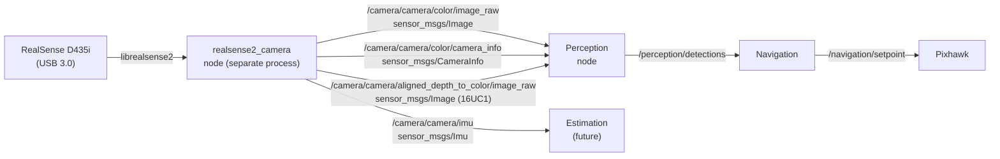

## Short answer

Don't link `librealsense` into `cogidrone`. Run Intel's `realsense2_camera` node as a **separate process** on the Jetson; it publishes plain `sensor_msgs/msg/Image` topics that your existing `Perception` node already knows how to subscribe to. Your architecture is already built for this — `perception.cpp:76` subscribes to `/camera/image` with `sensor_msgs::msg::Image`.



---

## 1. Install the driver on the Jetson

Your vendored deb index already contains the packages (`ros-Packages`) — `ros-jazzy-realsense2-camera` 4.58.4, `ros-jazzy-librealsense2`, `ros-jazzy-cv-bridge`, `ros-jazzy-image-transport`, `ros-jazzy-image-geometry`. But only the **core** ROS packages are actually extracted into `vendored/ros2` (see the `ROS_PKGS` list in `get.sh`). So install natively on the Jetson:

```bash
sudo apt install ros-jazzy-realsense2-camera ros-jazzy-librealsense2 \
                 ros-jazzy-cv-bridge ros-jazzy-image-transport
```

You do **not** need to vendor `realsense2_camera` headers for IntelliSense — everything you subscribe to (`Image`, `CameraInfo`, `PointCloud2`, `Imu`) is already in `sensor_msgs`, which is vendored and already linked in `src/CMakeLists.txt`.

## 2. Launch the camera

```bash
ros2 launch realsense2_camera rs_launch.py \
    enable_color:=true \
    enable_depth:=true \
    enable_sync:=true \
    align_depth.enable:=true \
    pointcloud.enable:=true \
    depth_module.profile:=640x480x30 \
    rgb_camera.profile:=640x480x30 \
    color_qos:=SENSOR_DATA \
    depth_qos:=SENSOR_DATA
```

`align_depth.enable:=true` is the important one — it resamples depth onto the **color** pixel grid, so pixel `(u,v)` in the RGB image and pixel `(u,v)` in the depth image refer to the same physical ray. Without it you need the `depth_to_color` extrinsics to reproject.

## 3. Topics a D435i gives you

Note the **double namespace** `/camera/camera/...` — `camera_namespace` and `camera_name` both default to `camera` in Jazzy.

| Topic | Type | Notes |
|---|---|---|
| `/camera/camera/color/image_raw` | `sensor_msgs/msg/Image` | `rgb8`, 640×480×30 |
| `/camera/camera/color/camera_info` | `sensor_msgs/msg/CameraInfo` | `K`, `D`, `P` intrinsics |
| `/camera/camera/depth/image_rect_raw` | `sensor_msgs/msg/Image` | `16UC1`, **millimetres** |
| `/camera/camera/aligned_depth_to_color/image_raw` | `sensor_msgs/msg/Image` | `16UC1`, aligned to color — **use this one** |
| `/camera/camera/depth/color/points` | `sensor_msgs/msg/PointCloud2` | XYZRGB, for Representation |
| `/camera/camera/imu` | `sensor_msgs/msg/Imu` | BMI055, needs `enable_gyro:=true enable_accel:=true` |
| `/camera/camera/extrinsics/depth_to_color` | `realsense2_camera_msgs/msg/Extrinsics` | only if you skip `align_depth` |

Verify before touching C++:

```bash
ros2 topic hz /camera/camera/color/image_raw
ros2 topic echo --once /camera/camera/color/camera_info
```

## 4. Wire it into `Perception`

Your `M` struct needs two more subscriptions. In `perception.h`:

```cpp
#include "sensor_msgs/msg/camera_info.hpp"

struct M {
    rclcpp::Node::SharedPtr node;

    rclcpp::Subscription<sensor_msgs::msg::Image>::SharedPtr      imageSubscription;
    rclcpp::Subscription<sensor_msgs::msg::Image>::SharedPtr      depthSubscription;   // aligned depth
    rclcpp::Subscription<sensor_msgs::msg::CameraInfo>::SharedPtr cameraInfoSubscription;

    rclcpp::Publisher<vision_msgs::msg::Detection2DArray>::SharedPtr targetPublisher;

    Person personModel;
    Head headModel;
    DepthAnything depthAnythingModel;
} m;
```

In `wire()` — **this is where the QoS matters** (see gotcha #1):

```cpp
void Perception::wire() noexcept {
    m.imageSubscription = m.node->create_subscription<sensor_msgs::msg::Image>(
        "/camera/camera/color/image_raw",
        rclcpp::SensorDataQoS(),
        [this](const sensor_msgs::msg::Image& msg) { this->onFrame(msg); }
    );

    m.depthSubscription = m.node->create_subscription<sensor_msgs::msg::Image>(
        "/camera/camera/aligned_depth_to_color/image_raw",
        rclcpp::SensorDataQoS(),
        [this](const sensor_msgs::msg::Image& msg) { this->onDepth(msg); }
    );

    m.cameraInfoSubscription = m.node->create_subscription<sensor_msgs::msg::CameraInfo>(
        "/camera/camera/color/camera_info",
        rclcpp::SensorDataQoS(),
        [this](const sensor_msgs::msg::CameraInfo& msg) { this->onCameraInfo(msg); }
    );

    m.targetPublisher = m.node->create_publisher<vision_msgs::msg::Detection2DArray>(
        "/perception/detections", rclcpp::QoS(10));
}
```

## 5. `Image` → `cv::Mat` (your `toFrame` TODO)

Two options. **Manual wrap** (no new dependency, fits your style):

```cpp
// Zero-copy view over the message buffer. Valid ONLY inside the callback.
[[nodiscard]] static cv::Mat toFrame(const sensor_msgs::msg::Image& msg) {
    if (msg.encoding == "rgb8")
        return {static_cast<int>(msg.height), static_cast<int>(msg.width),
                CV_8UC3, const_cast<uint8_t*>(msg.data.data()), msg.step};
    if (msg.encoding == "bgr8")
        return {static_cast<int>(msg.height), static_cast<int>(msg.width),
                CV_8UC3, const_cast<uint8_t*>(msg.data.data()), msg.step};
    if (msg.encoding == "mono8")
        return {static_cast<int>(msg.height), static_cast<int>(msg.width),
                CV_8UC1, const_cast<uint8_t*>(msg.data.data()), msg.step};
    if (msg.encoding == "16UC1")                                        // depth, mm
        return {static_cast<int>(msg.height), static_cast<int>(msg.width),
                CV_16UC1, const_cast<uint8_t*>(msg.data.data()), msg.step};
    throw std::runtime_error("unsupported encoding: " + msg.encoding);
}
```

Note `msg.step` — rows can be padded, so never assume `step == width * channels`.

**Or `cv_bridge`** if you'd rather not hand-roll it:

```cpp
#include <cv_bridge/cv_bridge.hpp>
auto cv_ptr = cv_bridge::toCvShare(msg, msg.encoding);   // still zero-copy
```

That requires adding `cv_bridge` + OpenCV to `ROS_PKGS` in `get.sh` and linking `cv_bridge` + `${OpenCV_LIBS}` in `src/CMakeLists.txt`. Given you already have a `toFrame` TODO in `perception.cpp:100`, the manual version is probably the better fit.

## 6. Bounding box → 3D point

This is the piece `navigation.cpp:202` is waiting for (`person.position = ...`). With `aligned_depth_to_color` and `CameraInfo::k`:

```cpp
// depth in mm (16UC1) -> metres
const float Z = static_cast<float>(depth.at<uint16_t>(v, u)) * 0.001f;
if (Z <= 0.0f) return std::nullopt;                                     // invalid / no return

const float fx = static_cast<float>(cameraInfo.k[0]);
const float fy = static_cast<float>(cameraInfo.k[4]);
const float cx = static_cast<float>(cameraInfo.k[2]);
const float cy = static_cast<float>(cameraInfo.k[5]);

const float X = (static_cast<float>(u) - cx) * Z / fx;
const float Y = (static_cast<float>(v) - cy) * Z / fy;
```

$$X = \frac{(u - c_x)\,Z}{f_x}, \qquad Y = \frac{(v - c_y)\,Z}{f_y}, \qquad Z = \text{depth}[v][u]\cdot 10^{-3}$$

Sample a small patch around the bbox centre (e.g. 5×5 median) rather than a single pixel — depth is noisy and the bbox centre often lands on a hole. Then transform `camera_color_optical_frame` → `base_link` → `world` with TF2, as sketched in `NAVIGATION_DESIGN.md`.

---

## Gotchas that will bite you

**1. QoS mismatch — silent total failure.** `realsense2_camera` defaults `<stream>_qos` to `SYSTEM_DEFAULT` (**reliable**). Your `rclcpp::SensorDataQoS()` is **best-effort**. A reliable publisher and a best-effort subscriber are *incompatible* — you get zero messages and no error. Either pass `color_qos:=SENSOR_DATA depth_qos:=SENSOR_DATA` at launch (recommended, matches your code) or switch `Perception` to `rclcpp::QoS(10)`. Confirm with `ros2 topic info -v /camera/camera/color/image_raw`.

**2. Intra-process comms won't help across processes.** `perception.cpp:60` sets `use_intra_process_comms(true)`, but `cogidrone` is a standalone executable, not a component container — so the camera node is in a different process and you pay a DDS copy per frame. At 640×480×30 that's ~27 MB/s, fine on a Jetson. If you ever need true zero-copy, you'd have to convert `cogidrone` into an `rclcpp_components` container and load `realsense2_camera::RealSenseNodeFactory` into it with `-e use_intra_process_comms:=true`. Note compressed `image_transport` is disabled under intra-process.

**3. Optical frame convention.** `header.frame_id` is `camera_color_optical_frame` — **Z forward, X right, Y down**. Your body frame is FLU. Your commented-out `cameraToWorld` at `navigation.cpp:482` assumes camera ≡ body, which will give you a drone that flies sideways. Publish a static `base_link → camera_link` transform for the physical mount and let TF2 handle the optical rotation.

**4. USB 3.0 is mandatory.** Check `lsusb -t` shows `5000M` for the D435i. On USB 2 it silently drops to low-res/low-fps or fails to enumerate. Use the Jetson's USB 3 ports, not a hub.

**5. Timestamps.** `header.stamp` comes from the camera clock, not the Jetson's. If you later fuse with PX4/IMU data, you need `ros2 run tf2_ros` / `message_filters` time sync or a `timestamp` offset parameter.

**6. `enable_sync:=true` is frame-time matching, not hardware sync.** The D435i has no HW sync connector; librealsense matches color/depth by frame timestamp. Expect occasional dropped pairs at 30 fps in low light.

---

## Alternative: link `librealsense2` directly

You *could* `#include <librealsense2/rs.hpp>` and run `rs2::pipeline` inside `Perception`, skipping ROS entirely. You'd get `rs2::frameset`, `rs2::align(RS2_STREAM_COLOR)`, and `profile.get_intrinsics()` with no DDS copy.

I'd advise against it here:
- You lose `ros2 topic hz`, `rqt_image_view`, `rviz2`, and `ros2 bag record` — which is most of your debugging ability on a drone.
- It contradicts the composition design documented in `drone.h`.
- Cross-compiling librealsense for ARM64 from your Windows/Docker toolchain (`build.sh`, `CMakePresets.json`) is significantly more painful than `apt install`.

The ROS wrapper is the right call for this architecture.

---

I'm in ask mode, so I haven't changed anything. If you want the `Perception` wiring, `toFrame`, and depth→3D fusion actually implemented, switch to an agent mode with write access and I'll do it.